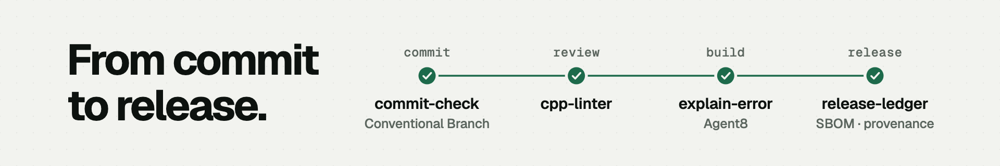

<picture>
  <source media="(prefers-color-scheme: dark)" srcset="assets/brand/github-dark-1920x320.png">
  <source media="(prefers-color-scheme: light)" srcset="assets/brand/github-light-1920x320.png">
  
</picture>

I build open-source guardrails for software delivery: the checks that run between a commit and a release, whether a person or an AI agent wrote the code. I have worked on the build, test and release side of software since 2009.

[Blog][blog] · [About][about] · [X][x] · [LinkedIn][linkedin] · [RSS][rss] · [Sponsor][sponsors]

## Open source

`commit` &nbsp;[**commit-check**][commit-check] checks commit messages, branch names, authors, sign-offs and AI attribution from one config file, in CI or as a pre-commit hook. About 55,000 downloads a month on PyPI. Its branch rules follow [**Conventional Branch**][conventional-branch], a naming spec with a JSON Schema and conformance fixtures.

`review` &nbsp;[**cpp-linter**][cpp-linter] runs clang-format and clang-tidy on every pull request and posts the results back as review comments. It ships as a [GitHub Action][cpp-linter-action], a [pre-commit hook][cpp-linter-hooks] and a [Python package][cpp-linter-pypi]. The clang-format and clang-tidy it runs come from the [static binaries][clang-tools] I maintain for each LLVM version, downloaded more than 750,000 times. GitHub counts more than 1,000 repositories that depend on cpp-linter, including projects from:

   <b>Apache</b>&nbsp;&nbsp;
   <b>Samsung</b>&nbsp;&nbsp;
   <b>Qualcomm</b>&nbsp;&nbsp;
   <b>Bloomberg</b>&nbsp;&nbsp;
   <b>LLNL</b>&nbsp;&nbsp;
   <b>Stanford SSI</b>&nbsp;&nbsp;
   <b>Nextcloud</b>

`build` &nbsp;In the jenkinsci organization I maintain [**explain-error**][explain-error-plugin], which explains failed Jenkins builds with AI, and [**jenkinsfilelint**][jenkinsfilelint]. [**Agent8**][agent8] keeps build hosts stuck on Java 8 connected to a current Jenkins.

`release` &nbsp;[**release-ledger**][release-ledger], my newest project, runs when you publish a release. It attaches an SBOM, signs build provenance, and then checks every version still in its support period against known exploited vulnerabilities, which the EU Cyber Resilience Act now requires you to report within 24 hours.

Also [gitstats][gitstats], which turns a Git history into an HTML report, [mkdocs-ng][mkdocs], and merged pull requests in [Python][python-prs] and [PyPA][pypa-prs].

## Infrastructure you own

- [**keelinfra**][keelinfra]: [Agent8][agent8], which keeps build hosts stuck on Java 8 (AIX, Solaris, HP-UX) connected to a current Jenkins, and [release-ledger][release-ledger], which records the EU Cyber Resilience Act evidence for every release. Free to run yourself, with [support plans][keelinfra-pricing] for teams that want someone to call.
- [**keelapps**][keelapps]: twelve admin apps for Jira and Confluence Cloud, built on Forge so they run inside your own tenant.
- [**Keelhaven**][keelhaven]: Mac backup to storage you own. Free and open source.

## Writing

<!-- BLOG-POST-LIST:START -->
- [Old Jenkins Straight to 2.580.1: 12 LTS Lines Fail to Start, Online or Not](https://shenxianpeng.dev/posts/2026/jenkins-2-580-old-upgrade/) - Oct 21, 2026
- [Jenkins Needs Java 21, Your Old Build Hosts Stop at Java 8: I Built Agent8](https://shenxianpeng.dev/posts/2026/agent8/) - Oct 16, 2026
- [Keelhaven Releases New Version—This Time, Updates Come from Real User Feedback](https://shenxianpeng.dev/posts/2026/keelhaven-0-8-0/) - Sep 9, 2026<!-- BLOG-POST-LIST:END -->

More [on the blog][blog]. 中文读者请关注公众号「[沈显鹏][qrcode]」。

[about]: https://shenxianpeng.dev/about/
[blog]: https://shenxianpeng.dev/posts/
[rss]: https://shenxianpeng.dev/index.xml
[x]: https://x.com/xianpengshen
[linkedin]: https://www.linkedin.com/in/xianpeng-shen/
[qrcode]: https://github.com/shenxianpeng/blog/blob/main/assets/img/qrcode.jpg
[sponsors]: https://github.com/sponsors/shenxianpeng
[commit-check]: https://github.com/commit-check/commit-check
[conventional-branch]: https://conventionalbranch.org
[cpp-linter]: https://github.com/cpp-linter
[cpp-linter-action]: https://github.com/cpp-linter/cpp-linter-action
[cpp-linter-hooks]: https://github.com/cpp-linter/cpp-linter-hooks
[cpp-linter-pypi]: https://pypi.org/project/cpp-linter/
[explain-error-plugin]: https://github.com/jenkinsci/explain-error-plugin
[jenkinsfilelint]: https://github.com/jenkinsci/jenkinsfilelint
[agent8]: https://github.com/keelinfra/agent8
[clang-tools]: https://github.com/cpp-linter/clang-tools-static-binaries
[release-ledger]: https://github.com/keelinfra/release-ledger
[gitstats]: https://github.com/shenxianpeng/gitstats
[mkdocs]: https://github.com/mkdocs-ng/mkdocs
[python-prs]: https://github.com/search?q=is%3Apr+author%3Ashenxianpeng+is%3Amerged+user%3Apython&type=pullrequests
[pypa-prs]: https://github.com/search?q=is%3Apr+author%3Ashenxianpeng+is%3Amerged+user%3Apypa&type=pullrequests
[keelinfra]: https://keelinfra.io
[keelinfra-pricing]: https://keelinfra.io/jenkins/pricing/
[keelapps]: https://keelapps.app
[keelhaven]: https://keelhaven.app
